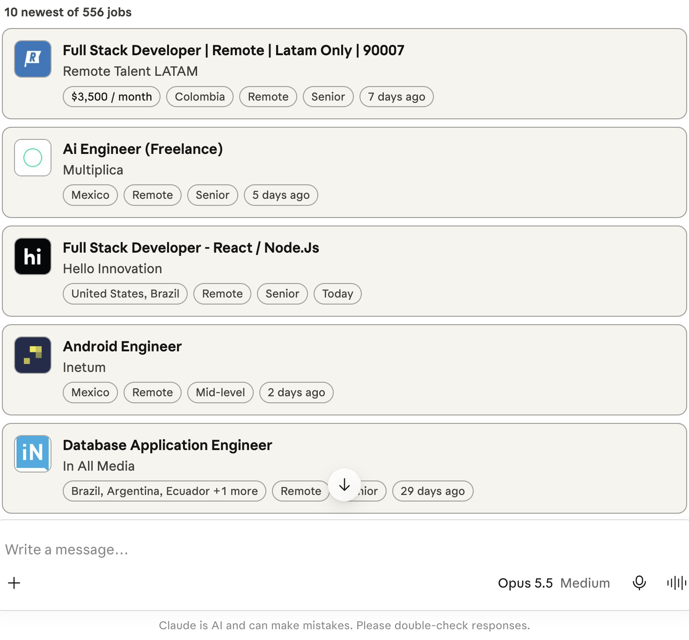

# Aworkado MCP server

Search live remote and hybrid jobs from [Aworkado](https://aworkado.co) inside Claude, ChatGPT, Cursor or any other MCP client.

Aworkado collects job postings straight from the career pages of thousands of employers (Greenhouse, Lever, Ashby, Workable, SmartRecruiters and more) and checks them again every day or two. This server lets an AI assistant search those postings and open any of them in full.

```
https://aworkado.co/mcp
```

Streamable HTTP. No account, no API key, read-only. Free.



## Connect

**Claude** (claude.ai, desktop, mobile): Customize → Connectors → Add custom connector. Name it Aworkado, paste the URL, choose **No sign-in**.

**Claude Code**

```sh
claude mcp add --transport http aworkado https://aworkado.co/mcp
```

**ChatGPT**: turn on developer mode, then create a connector with the URL and no authentication.

**Cursor, VS Code, Goose and other clients**: add a remote HTTP server.

```json
{
  "mcpServers": {
    "aworkado": { "url": "https://aworkado.co/mcp" }
  }
}
```

## Tools

### `search_jobs`

Finds live remote and hybrid postings. Every filter is optional, and filters combine with AND.

| Parameter | What it takes |
|---|---|
| `query` | Keywords matched against the job title and company, e.g. `python backend`, `Stripe` |
| `jobFunction` | One of: Software Engineering, Data & Analytics, DevOps & Cloud, QA & Testing, IT & Security, Hardware Engineering, Product Management, Project Management, Design, Marketing, Sales, Business Development, Account Management, Customer Support, Operations, Finance & Accounting, HR & Recruiting, Legal & Compliance, Writing & Content, Education & Training, Healthcare, Research, Consulting, Administrative, Other |
| `countries` | ISO 3166-1 alpha-2 codes the candidate can work from, e.g. `["IN", "PH"]` |
| `region` | `europe`, `latin-america`, `asia`, `africa`, `middle-east`, `north-america`, `oceania`, or `anywhere` |
| `workplace` | `remote` or `hybrid` (both when left out) |
| `level` | `Entry`, `Mid-level` or `Senior` |
| `postedWithin` | `day`, `week` or `month` |

It returns the ten newest matches, the total count and a link to the full list on aworkado.co. In hosts that support [MCP Apps](https://modelcontextprotocol.io/docs/extensions/apps), the results render as job cards; the widget source is in [`widget/job-widget.html`](widget/job-widget.html).

### `get_job`

Takes a `jobId` from a search result and returns the full posting: description, key points, salary when the employer gives one, the countries it is open to, and the link.

## Try asking

- Find remote customer support jobs open to people in India.
- Senior backend engineer jobs in Europe posted this week.
- Hybrid product designer jobs in Latin America.
- Entry-level remote data analyst jobs in the Philippines.
- Tell me more about the second job.

## Listings

- Official MCP Registry: [`co.aworkado/jobs`](https://registry.modelcontextprotocol.io/v0/servers?search=co.aworkado) ([server.json](server.json))
- [Glama](https://glama.ai/mcp/connectors/co.aworkado/jobs)

## Privacy and support

The assistant sends Aworkado only the search filters it chose, never your conversation or account. See the [privacy policy](https://aworkado.co/privacy) and [terms](https://aworkado.co/terms). Docs: [aworkado.co/ai-assistants](https://aworkado.co/ai-assistants).

Questions or bugs: open an issue or write to hello@aworkado.co.

## License

The widget and the files in this repository are MIT licensed. The server itself runs on aworkado.co and is not part of this repository.
