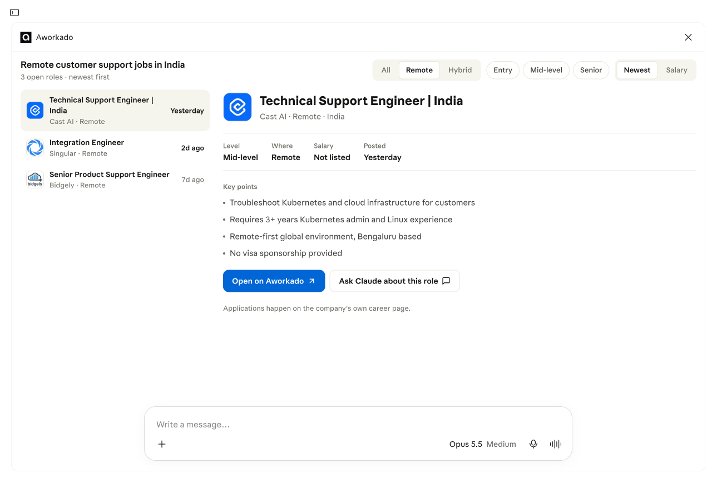

# Aworkado MCP server

Ask Claude, ChatGPT, Cursor or any other MCP client for remote and hybrid jobs, and get live postings from [Aworkado](https://aworkado.co).

Aworkado pulls job postings from the career pages of thousands of employers (Greenhouse, Lever, Ashby, Workable, SmartRecruiters and others) and checks each one again every day or two. This server gives your assistant access to them: it can search the postings and read any of them in full.

```
https://aworkado.co/mcp
```

It speaks Streamable HTTP and needs no account or API key. It only reads data, and it's free.


## Connect

**Claude** (web, desktop and mobile): open Customize → Connectors → Add custom connector, name it Aworkado, paste the URL and pick **No sign-in**.

**Claude Code**

```sh
claude mcp add --transport http aworkado https://aworkado.co/mcp
```

**ChatGPT**: turn on developer mode, then create a connector with the URL and no authentication.

**Cursor, VS Code, Goose and other clients**: add it as a remote HTTP server, for example:

```json
{
  "mcpServers": {
    "aworkado": { "url": "https://aworkado.co/mcp" }
  }
}
```

## Tools

### `search_jobs`

Searches live remote and hybrid postings. All filters are optional; when you give several, a posting has to match all of them.

| Parameter | What it takes |
|---|---|
| `query` | Keywords matched against the job title and company, e.g. `python backend`, `Stripe` |
| `jobFunction` | One of: Software Engineering, Data & Analytics, DevOps & Cloud, QA & Testing, IT & Security, Hardware Engineering, Product Management, Project Management, Design, Marketing, Sales, Business Development, Account Management, Customer Support, Operations, Finance & Accounting, HR & Recruiting, Legal & Compliance, Writing & Content, Education & Training, Healthcare, Research, Consulting, Administrative, Other |
| `countries` | ISO 3166-1 alpha-2 codes the candidate can work from, e.g. `["IN", "PH"]` |
| `region` | `europe`, `latin-america`, `asia`, `africa`, `middle-east`, `north-america`, `oceania`, or `anywhere` |
| `workplace` | `remote` or `hybrid` (both when left out) |
| `level` | `Entry`, `Mid-level` or `Senior` |
| `postedWithin` | `day`, `week` or `month` |

You get the ten newest matches, the total number of matches and a link to the full list on aworkado.co.

Hosts that support [MCP Apps](https://modelcontextprotocol.io/docs/extensions/apps), like Claude, show the results as a table. Click a row to see the key points and the link, or ask the assistant about that role. The expand button opens a full-screen view where you can filter by workplace and level, sort by salary and load more postings. The widget's source is in [`widget/job-widget.html`](widget/job-widget.html).



### `get_job`

Opens one posting from the search results by its `jobId`. It returns the description, a short summary, the salary if the employer lists one, the countries the job is open to, and the link.

### `browse_jobs`

The widget's own paged search for the full-screen view. Hosts hide it from the model (`_meta.ui.visibility: ["app"]`), so the assistant only sees the two tools above.

## Try asking

- Find remote customer support jobs open to people in India.
- Senior backend engineer jobs in Europe posted this week.
- Hybrid product designer jobs in Latin America.
- Entry-level remote data analyst jobs in the Philippines.
- Tell me more about the second job.

## Listings

- Official MCP Registry: [`co.aworkado/jobs`](https://registry.modelcontextprotocol.io/v0/servers?search=co.aworkado) ([server.json](server.json))
- [Glama](https://glama.ai/mcp/connectors/co.aworkado/jobs)

## Privacy and support

Your assistant sends Aworkado the search filters it chose and nothing else. We never see your conversation or your account. Details are in the [privacy policy](https://aworkado.co/privacy) and the [terms](https://aworkado.co/terms), and there's a user guide at [aworkado.co/ai-assistants](https://aworkado.co/ai-assistants).

Found a bug or have a question? Open an issue or write to hello@aworkado.co.

## License

Everything in this repository, including the widget, is MIT licensed. The server itself runs on aworkado.co, and its code isn't published here.
